# UML Class Diagram

An Obsidian plugin that builds an interactive UML class diagram from the code in your vault: pick a folder, set a few flags, press **Создать** — and the diagram opens in its own tab.



Diagrams are interactive: classes expand to show fields and methods, hovering a member highlights its relation, a click pins a relation so you can follow where it goes, and the canvas pans, zooms and rearranges.

## Install

**Manual** — copy `main.js` and `manifest.json` into:

```
<your vault>/.obsidian/plugins/uml-class-diagram/
```

then restart Obsidian and enable **UML Class Diagram** in Settings → Community plugins.

**BRAT** — add `areaartez51/UML-Class-Diagram` in the BRAT plugin and install.

## Use

| Where | What |
|---|---|
| Ribbon (fork icon) | **UML: Создать** — pick a folder with sources, set flags, generate |
| Ribbon (network icon) | **UML: Открыть** — list of ready diagrams |
| Status bar `UML` | same as above, available from any tab |

Inside the generator:

| Field | Effect |
|---|---|
| Папка с C# | a vault path, or a full disk path on desktop (`D:\Unity\Project\Scripts`) |
| Учитывать вызовы | adds relations from method bodies: `_field.Call()`, `new T()`, `GetComponent<T>()` |
| Без связей от полей | keeps only inheritance, interfaces and calls |
| Без зависимостей от параметров | drops relations that come from parameter types |
| Зоны | group by folder, by namespace, automatically, or not at all |
| Исключить | glob relative to the folder, for example `**/Editor/**` |
| Пересобирать при сохранении .cs | rebuild quietly when a script in that folder changes |

## Where the result lives

The spec is saved as a normal note: `UML/<folder>.md`, with `uml-diagram: true` in the frontmatter and the JSON in a fenced block. Opening that note in reading view renders the diagram in place of the block, so a spec note needs no special command to be looked at.

## Limits

- **C# only for now.** The extractor parses C#; other languages are not implemented.
- **External folders need the desktop app.** Reading a path outside the vault uses Node, which the mobile app does not provide.
- **Regenerate-on-save works inside the vault.** Files outside it produce no file events to watch.
- Export to SVG and PNG is in the panel; PNG is rendered up to 2× (capped at 4200 px per side).

## Build from source

The renderer is shared with the [dsh-uml-class](https://github.com/areaartez51/dsh-uml-class) skill and vendored here, so one copy of the drawing code serves both artefacts.

```bash
node sync-vendor.mjs            # copy the renderer from a sibling checkout
node build.mjs                  # bundle main.js
node verify.mjs                 # print a scratch dir; run its run.cjs to smoke-test the bundle
node docs/generate-preview.mjs  # refresh the preview above from docs/example.json
```

`vendor/HASHES.json` records what was copied; `build.mjs` refuses to build when the files and the record disagree, so the two copies cannot drift apart silently.

## License

MIT — see [LICENSE](LICENSE).
